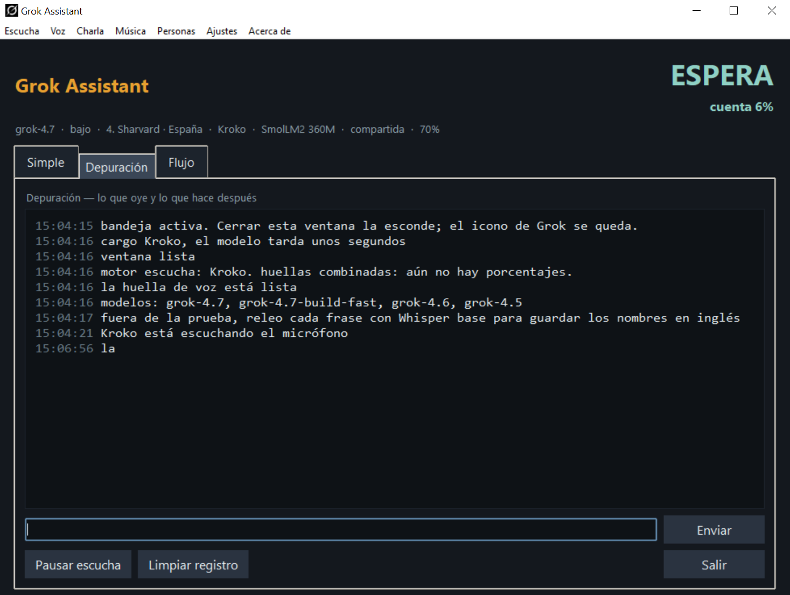
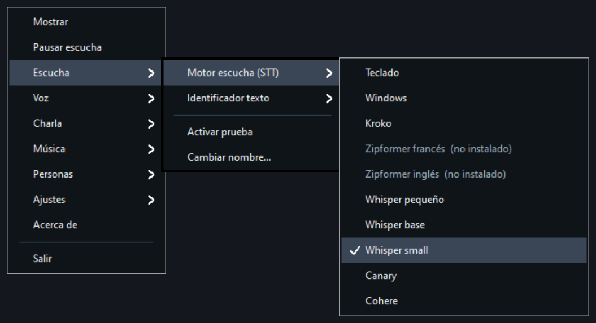
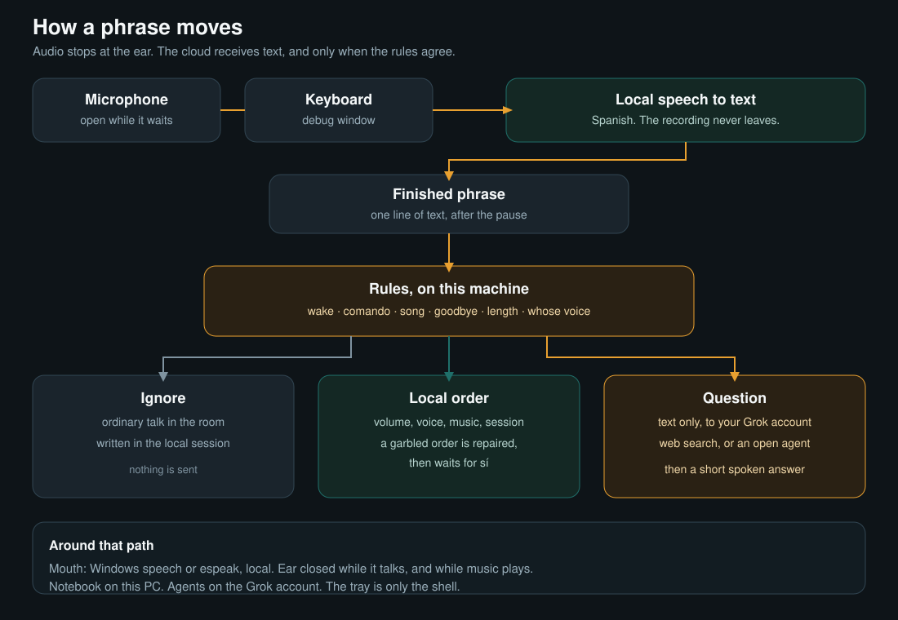

[Leer en español](README.ES.md) · [Lire en français](README.FR.md) · [Auf Deutsch lesen](README.DE.md)

# Grok Assistant

Release candidate 1.0.5.

This is a voice companion for the moments when reading is difficult and the house is quiet. The laptop version is for an older person who already has a small computer nearby. The Raspberry Pi 4 version, with 4 GB of RAM, is the same assistant as a dedicated device, for a family that would rather not leave a laptop open. That parallel project is [Grok Pi Assistance](https://github.com/antonio-castellon/Grok_Pi_Assistance). The microphone can stay ready. The audio stays on the computer. Only text that was meant for the assistant is sent out.

I spent years waiting for the Amazon Echo to become a better listener. It never really became more than a speaker with a light ring, so I decided to build my own.

In my case, that person is my father. His eyesight is limited, and he spends many hours on his own. I wanted him to have a voice he could simply talk to — one that could answer questions and explain things without making him find a screen or read small text. That is now possible. Grok on this machine is also the foundation for the features and integrations I plan to add next.

For the assistant to hear properly, record a voice print on the microphone you will use: **People → Prints**. Without that print the program hears the room and drops the phrase, before the local model and before any order. The print is there so two people in the same place, the television, and the assistant's own voice do not mix into one conversation. The microphone stays open while the assistant speaks. Another microphone needs its own recording. The rest is in [Voice prints and listeners](docs/en/prints.md).

While the program is running, it can keep listening. Speech is turned into text on this computer. Grok only receives text when the assistant has actually been addressed: after a greeting, for a question, for a command beginning with `comando`, or when someone asks for a song. Ordinary conversation stays in the local session. If a command is unclear or misheard, Grok can help interpret it, but the assistant still asks for a `sí` before doing anything.

That is the basic idea. Below are the listening window and the icon menu, with Escucha open. The pictures are the same in every language.

The diagram below shows what happens to a spoken phrase from the moment it is heard.

In Settings, Grok only searches the internet. An administrator can allow Grok to change files on this machine. The shell stays off, and a relative path lands in the assistant data folder.

## Read on

- [How to use it](docs/en/guide.md)
- [Look](docs/en/look.md)
- [Voice prints and listeners](docs/en/prints.md)
- [Tips](docs/en/tips.md)
- [Sessions and agents](docs/en/sessions.md)
- [Why Grok, and not another chat window](docs/en/why-grok.md)
- [What is actually running](docs/en/pieces.md)
- [What you can say](docs/en/saying.md)
- [Run the executable](docs/en/run.md)
- [Run it from the source tree](docs/en/source.md)

## Notice and Disclaimer

NOTICE AND DISCLAIMER: This software automatically retrieves, accesses or interacts with external materials. Those retrieved materials are not distributed with this software and are governed solely by separate terms, conditions and licenses. You are solely responsible for finding, reviewing and complying with all applicable terms, conditions, and licenses, and for verifying the security, integrity and suitability of any retrieved materials for your specific use case. This software is provided "AS IS", without warranty of any kind. The author makes no representations or warranties regarding any retrieved materials, and assumes no liability for any losses, damages, liabilities or legal consequences from your use or inability to use this software or any retrieved materials. Use this software and the retrieved materials at your own risk.

External materials Grok_Assistant interacts with at run time:

- Grok (grok.com) through your own account, under xAI's terms.
- Speech, voice and language models downloaded from Hugging Face (huggingface.co), such as Whisper, Piper voices and GGUF models (Qwen2.5, SmolLM2, Llama-3.2), each under its own model license.
- GitHub (api.github.com, github.com), under GitHub's terms.
